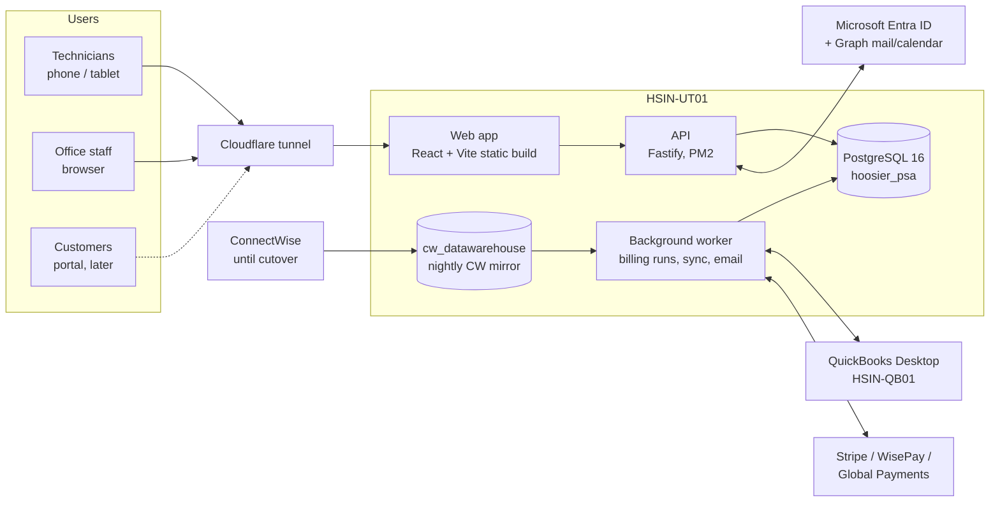

# 02. Architecture

## System context



## Components

| Component | Technology | Responsibility |
|---|---|---|
| `apps/web` | React 19, Vite, TypeScript | Staff UI and technician mobile views. Calls the API only. |
| `apps/api` | Fastify 5, TypeScript, `pg` | HTTP API: validation, authorization, transactions, audit actor. |
| worker (milestone 2) | Same codebase, separate PM2 process | Scheduled and queued work: billing runs, QuickBooks sync, inbound mail, payment retries. |
| `packages/db` | SQL migrations, runner | The schema, owned by this repository only. |
| `packages/shared` | TypeScript, zod, decimal.js | Pure business rules and contracts used by both sides. |

### Why these choices

- **TypeScript end to end** keeps contracts, validation and business rules in one language with one
  set of types ([ADR 0001](adr/0001-typescript-monorepo.md)).
- **SQL-first, no ORM.** Hand-written parameterised SQL keeps queries visible, reviewable and
  tunable, which matters for billing and reporting ([ADR 0004](adr/0004-sql-first-data-access.md)).
- **A dedicated database** separates this system of record from the ETL-owned mirror
  ([ADR 0002](adr/0002-dedicated-database.md)).

## Data ownership

| Database | Owner | Writes | Purpose |
|---|---|---|---|
| `cw_datawarehouse` | Existing ETL (`C:\cw-etl`) | ETL only | Nightly CW mirror, QuickBooks sync, reporting. Read-only to this project. |
| `hoosier_psa` | This repository | API and worker | System of record after cutover; shadow copy before it ([11](11-cw-migration.md)). |

The app reads the mirror only through the import tooling, using the read-only `cw_readonly` role.

## API conventions

- Base path `/api/v1`. JSON in and out; field names `camelCase`; ids are numbers; timestamps ISO 8601 UTC.
- Resources are plural nouns: `/companies`, `/tickets`, `/time-entries`. Sub-resources nest once
  (`/tickets/:id/notes`).
- Lists accept `limit` (1-200, default 50), `offset`, and resource-specific filters; they return
  `{ items, total, limit, offset }`.
- Errors are `application/problem+json` (RFC 9457): `type`, `title`, `status`, optional `detail` and
  per-field `errors`. Mapping: validation 400, unauthenticated 401, forbidden 403, missing 404,
  unique violation 409, bad reference or rule violation 422.
- Every request is authorized by permission key ([08](08-security.md)); every write runs inside
  `withActor` so `sys.audit_log` records who did it.
- Mutations that must not double-apply (payments, billing runs, QuickBooks exports) accept an
  `Idempotency-Key` header and persist the outcome per key.
- Health: `GET /healthz` (process), `GET /readyz` (database).

## Module boundaries

Each business area owns a PostgreSQL schema and a folder of routes and services:

```
crm  catalog  service  timekeeping   (milestone 0 schema)
agreement  billing  accounting        (milestone 2)
dispatch  project                     (milestone 3)
sales  procurement                    (milestone 4)
payments                              (milestone 5)
```

Rules: a module reads another module's tables only through its published views or service functions,
never joins into its private tables from application code; cross-module references are foreign keys
to stable ids. Circular references are resolved by adding the foreign key in the later migration
(for example `service.ticket.agreement_id` gains its constraint in the agreements migration).

## Deployment (HSIN-UT01)

- API and worker run under PM2 beside the existing apps; the built web app is served as static files
  behind the same Cloudflare tunnel, with `/api` routed to the API.
- Environments: **dev** (laptop), **shadow** (nightly re-import from the mirror; for testing and parallel run),
  **prod** (empty until cutover). Ports and PM2 names are recorded in the infrastructure notes when allocated.
- Migrations run as a deploy step (`pnpm db:migrate`) before the API restarts; the runner takes an
  advisory lock so two deploys cannot interleave.
- Backups: nightly `pg_dump` of `hoosier_psa` to a location off HSIN-UT01 and a monthly restore test
  (a backup that has not been restored is not a backup).

## Observability

Structured JSON logs (pino via Fastify) with request ids; `readyz` for the process monitor; the
worker logs every job with its outcome; business-level failures (a QuickBooks export rejecting an
invoice, a declined autopay) become rows in an `ops` inbox the billing team clears, not log lines
nobody reads.

## Background work

Scheduled and queued jobs use PostgreSQL itself (`SELECT ... FOR UPDATE SKIP LOCKED` on a job table),
avoiding a new infrastructure dependency at this scale. Jobs are idempotent and carry their own
retry and dead-letter state. This is revisited if volume ever warrants a broker.
