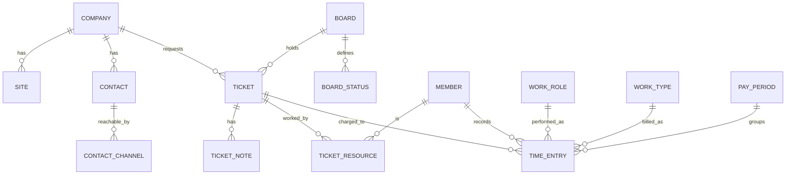

# 03. Domain model

The authoritative definition is the SQL in `packages/db/migrations`; this document explains the
shape and the conventions. Sections marked *(planned)* are designed but not yet migrated.

## Conventions

| Topic | Rule |
|---|---|
| Primary keys | `bigint GENERATED ALWAYS AS IDENTITY`. Imported rows keep their ConnectWise ids ([ADR 0003](adr/0003-preserve-cw-ids.md)). |
| Timestamps | `timestamptz`, stored UTC. `created_at` / `updated_at` on every table; `updated_at` maintained by trigger. |
| Dates | `date` for business dates (work date, invoice date), resolved in the member's or company's time zone before storage. |
| Money | `numeric(14,2)` amounts, `numeric(14,4)` unit prices and costs ([ADR 0006](adr/0006-money-and-rounding.md)). |
| Fixed value sets | `text` + `CHECK`. Admin-editable lists are lookup tables. |
| Names | Ids only; display names come from joins. No denormalised `*_name` columns. |
| Soft delete | `deleted_at` on records people expect to "delete" (companies, sites, contacts). Financial records are never deleted; they are voided. |
| Audit | `sys.attach_standard_triggers` adds `updated_at` and an audit row (old/new JSON, changed columns, acting member) per change. |
| Legacy link | `legacy_cw_*` columns hold the source ConnectWise id for traceable, re-runnable import. |
| Case-insensitive text | `citext` for identifiers and emails. |

## Schemas and entities

### `iam` (migrated)
`member` (staff, loaded labor cost, field-tech flag; credentials in `member_credential`), `role`, `permission`,
`role_permission`, `member_role`. Permission keys live in `packages/shared/src/permissions.ts`.

### `crm` (migrated)
`company` (billing profile, accounting links, soft delete), `company_status`, `company_type`,
`territory`, `site` (one default service site and one billing site per company, enforced by partial
unique indexes), `contact`, `contact_channel` (phones normalised to E.164 for caller matching),
`company_note` (alerts pop on open).

### `catalog` (migrated)
`tax_code`, `billing_terms`, `work_role` (standard bill rate), `work_type` (rate multiplier,
billable default, counts-against-agreement), `product_category`, `product` (price and cost to four
decimals, recurring flag, QuickBooks item name).

### `service` (migrated)
`board`, `board_status` (closed, default, pauses-SLA flags), `priority`, `ticket_type`,
`ticket_subtype`, `ticket_source`, `ticket`, `ticket_resource`, `ticket_note` (description,
discussion, internal, resolution), `ticket_attachment` (metadata, soft delete) and
`ticket_attachment_blob` (file bytes, deliberately not audited; [ADR 0011](adr/0011-attachments-in-postgres.md)).

A ticket's `billing_method` is `actual_rates`, `fixed_fee`, `not_to_exceed` or `override_rate`.
`agreement_id` and `project_id` are plain columns until the agreement and project migrations add the
foreign keys.

### `timekeeping` (migrated)
`pay_period` (non-overlapping, open/locked/exported), `time_entry`, `leave_entry`.
See [04](04-time-and-payroll.md) for lifecycle and invariants.

### `agreement`, `billing`, `accounting` *(planned, milestone 2)*
Agreements and additions with effective dates and prorating; billing runs that generate invoices from
agreements, time, products and expenses; invoices, lines, taxes and payments applied; accounting
export queue with per-record QuickBooks identifiers and results. See [05](05-billing-and-agreements.md)
and [06](06-accounting-integrations.md).

### `dispatch`, `project` *(planned, milestone 3)*
Schedule entries (a person on a ticket for a block of time, or a meeting or time off); overlaps for one person are allowed but reported and flagged, since dispatchers sometimes double-book on purpose; calendar sync state later;
projects, phases, project tickets, budgets, billing methods (fixed fee, milestone, time and materials).

### `procurement` *(built, milestone 4)*
`purchase_order` (draft, ordered, partial, received, closed short, canceled; optional links to a project, sales order and ticket), `purchase_order_line`, `receipt` and `receipt_line`. Quantity received is always computed from receipts. Only companies flagged as vendors can be ordered from. Receiving more than ordered is refused. Vendor bills (accounts payable) stay in QuickBooks.

### `sales` *(built)*; quotes arrive through `sales.external_ref` *(planned adapters)*
Opportunities, stages, quotes with versioned line items, activities; purchase orders, receipts,
vendor costs.

### `payments` *(planned, milestone 5)*
Payment methods (provider tokens only), autopay enrolments, payment attempts, ledger entries,
provider webhooks. See [10](10-payments-and-autopay.md).

## Invariants enforced by the database today

| Invariant | Mechanism |
|---|---|
| One running timer per member | Partial unique index on `time_entry (member_id) WHERE is_timer AND ended_at IS NULL` |
| Billed or period-locked time cannot change | `timekeeping.guard_locked_entry` trigger (override only with `app.allow_locked_edit`) |
| Pay periods never overlap | `EXCLUDE USING gist` on `daterange(start_date, end_date, '[]')` |
| An entry points at the thing it charges | `time_entry_charge_target` check |
| A billed entry has an invoice | `time_entry_billed_has_invoice` check |
| One default service site and one billing site per company | Partial unique indexes on `crm.site` |
| One default email and one default phone per contact | Partial unique index on `crm.contact_channel` |
| Case-insensitive unique company identifier, member identifier, email | `citext` unique constraints |
| Every change is attributable | `sys.audit_row` trigger on business tables |
| Applied migrations are immutable | Checksum comparison in the migration runner |
