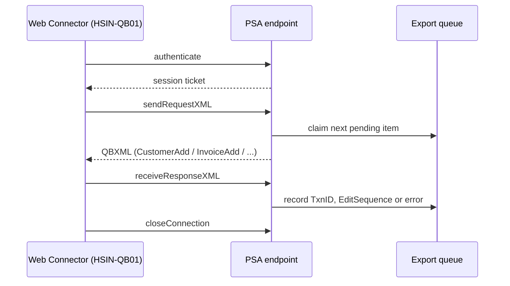

# 06. Accounting integrations

Principle: **the PSA is the operational record; QuickBooks is the general ledger.** The PSA pushes
accounting documents to QuickBooks and reads results back; it never reads QuickBooks to decide what to bill.

## QuickBooks Desktop (milestone 2)

QuickBooks Desktop runs on HSIN-QB01. It has no cloud API, so the integration uses the **QuickBooks Web
Connector (QBWC)**, an Intuit-supplied Windows service that runs beside QuickBooks and polls a SOAP endpoint
that we host, exchanging QBXML requests and responses.
*Details below are the design intent; a verification spike at the start of milestone 2 confirms each
against the installed QuickBooks version and Intuit's current documentation before build.*

### What is exported

| PSA record | QBXML | Linkage stored in PSA |
|---|---|---|
| Company (billing profile) | `CustomerAdd` / `CustomerMod` | `qb_customer_list_id` (stable) and full name |
| Product / service | `ItemServiceAdd` / `ItemNonInventoryAdd` (items are mapped, rarely created) | `qb_item_full_name` |
| Invoice | `InvoiceAdd` | QuickBooks `TxnID`, `EditSequence`, ref number |
| Credit memo | `CreditMemoAdd` | `TxnID` |
| Payment (milestone 5) | `ReceivePaymentAdd` applied to invoice | `TxnID` |

Vendor bills, purchasing and payroll stay in QuickBooks.

### Mapping rules

Mapping must reproduce what ConnectWise does today, or reports built on `qb_invoices` and
`qb_invoice_lines` change meaning. The first task of milestone 2 is a **mapping spike** that derives the
rules from history instead of guessing: analysing the ~34k synced QuickBooks invoices and their lines to learn how
CW picks the customer, item, income account, class, tax code and memo text. Known facts to preserve:

- Lines with no QuickBooks item (about 18% of dollar volume) are CW project-sync billing; the new
  system must emit the equivalent so downstream classification (by description such as `Ticket #...`,
  `Project:`) keeps working.
- Invoice reference numbers equal PSA invoice numbers and continue the CW sequence.

### Reliability

- **Queue, not calls.** Posting an invoice inserts an `accounting.export_item` (pending). The worker never
  blocks the user on QuickBooks.
- **Idempotency.** Before `InvoiceAdd`, query by reference number; if found, adopt its `TxnID` instead of
  adding a duplicate. Items carry a stable idempotency key.
- **Errors surface to people.** A rejection (inactive customer, unknown item, closed accounting period)
  creates a task for billing with the QuickBooks message and a retry action; nothing is silently dropped.
- **Ordering.** A customer must exist before its invoice; export items declare dependencies and wait.
- **Reconciliation.** A daily comparison of PSA invoice totals with the `qb_invoices` rows already synced by the
  existing nightly ETL reports any invoice missing, duplicated or different in amount.
- **Locking.** An invoice already exported is edited only by credit memo or void, never in place.
- **Security.** The endpoint is reachable only from HSIN-QB01 (IP allow-list or Cloudflare Access service
  token) and the Web Connector credential is a dedicated, rotatable account with no UI permissions.

## QuickBooks Online (milestone 5+)

Same export queue and mapping tables, different adapter (REST + OAuth 2.0). The adapter interface is
defined in milestone 2 so the second implementation is additive. `qbo_customer_id` is already reserved on
`crm.company`.

## Stripe (milestone 5)

Stripe is a payment provider adapter ([10](10-payments-and-autopay.md)), and `stripe_customer_id` is reserved on
`crm.company`. Stripe does not replace the accounting export: successful payments become PSA payment records,
which export to QuickBooks as payments (with fee lines, below).

## Processor fees

Today, merchant fees netted out of bank deposits cannot be seen in the synced QuickBooks data (deposit line
detail is not synced). The PSA records gross amount, fee and net per payment so the accounting export can post
fees as an expense and deposits reconcile exactly.
