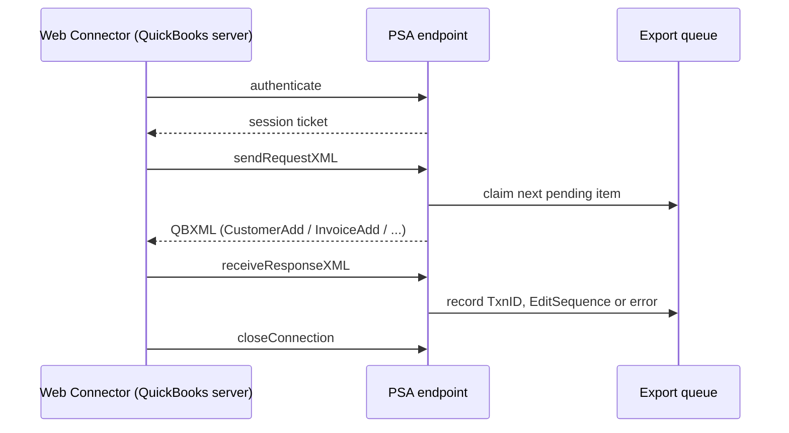

# 06. Accounting integrations

Principle: **the PSA is the operational record; QuickBooks is the general ledger.** The PSA pushes
accounting documents to QuickBooks and reads results back; it never reads QuickBooks to decide what to bill.

## QuickBooks Desktop (milestone 2)

QuickBooks Desktop runs on its own server (the QuickBooks server; name to be recorded). It has no cloud API, so the integration uses the **QuickBooks Web
Connector (QBWC)**, an Intuit-supplied Windows service that runs beside QuickBooks and polls a SOAP endpoint
that we host, exchanging QBXML requests and responses.
*Details below are the design intent; a verification spike at the start of milestone 2 confirms each
against the installed QuickBooks version and Intuit's current documentation before build.*

### What is exported

| PSA record | QBXML | Linkage stored in PSA |
|---|---|---|
| Company (billing profile) | `CustomerAdd` / `CustomerMod` | `qb_customer_list_id` (stable) and full name |
| Product / service | `ItemServiceAdd` / `ItemNonInventoryAdd` (items are mapped, rarely created) | `qb_item_full_name` |
| Invoice | `InvoiceAdd` | QuickBooks `TxnID`, `EditSequence`, ref number |
| Credit memo | `CreditMemoAdd` | `TxnID` |
| Payment (milestone 5) | `ReceivePaymentAdd` applied to invoice | `TxnID` |

Vendor bills, purchasing and payroll stay in QuickBooks.

### Mapping rules

Mapping must reproduce what ConnectWise does today, or reports built on `qb_invoices` and
`qb_invoice_lines` change meaning. The first task of milestone 2 is a **mapping spike** that derives the
rules from history instead of guessing: analysing the ~34k synced QuickBooks invoices and their lines to learn how
CW picks the customer, item, income account, class, tax code and memo text. Known facts to preserve:

- Lines with no QuickBooks item (about 18% of dollar volume) are CW project-sync billing; the new
  system must emit the equivalent so downstream classification (by description such as `Ticket #...`,
  `Project:`) keeps working.
- Invoice reference numbers equal PSA invoice numbers and continue the CW sequence.

### Mapping findings (spike, from invoices ConnectWise pushed since 2025-01-01, 8,630 invoices)

**Header.** Every invoice uses one AR account (`Accounts Receivable (AR)`) and the `Hoosier-Invoice` template; none has a
class or customer message, and none is marked to print (2 of 8,630 to e-mail). The reference number is the invoice
number. The header sales tax item is the customer's tax code: `Indiana Sales Tax` (84%), `Exempt` (15%), `Michigan
Sales Tax`, `Out of State`. Terms are QuickBooks names such as `Net 15` (70%), `Net 15 WisePay AutoPay`, `Net 30`,
`Due on Completion`, `Deposit + DOC`; the PSA's `billing_terms.qb_terms` must hold these exact names. Memos are rare
(18 invoices); PO numbers appear on 2,693.

**Lines.**
- A line's tax code is `Tax` when the line is taxable, otherwise `SRV`. Under an `Exempt` header every line is `SRV`.
  The code is not fixed per item (the same item appears under both), so it comes from the line's flag, as built.
- Recurring and product lines carry the product's QuickBooks item (`MONITORING`, `JFI-M`, `Hosted Access Control - RMR`,
  and so on) with the addition's description. Items live in `qb_items` (419 service, 348 non-inventory, 1,254
  inventory); only items that are active can be used.
- **Ticket labor has no item**: one line per time entry, quantity the hours, rate the bill rate, description
  `Ticket # <n>  Work Role: <role> Work Type: <type> Resource: <member>` followed by the ticket summary and notes, and a
  service date. This is about 2,400 lines and $255k in the period. Reports classify on the `Ticket #` text, so the PSA
  now starts its ticket lines with `Ticket # <n>`. Decision: keep one line per ticket and rate for now; going back to one
  line per entry with the role, work type and resource text may come later.
- Warranty and no-charge entries appear as zero-rate lines (for example `Work Type: Remote - WARRANTY`, 0.5 h at $0).
- Project billing also has no item and starts `Project: `; agreement credits start `Agreement`.
- Service dates are on almost every line (18,229 of 18,253); no descriptions exceed 4,000 characters.

**Invoice numbers.** The sequence is numeric and continuing (193417 on 2026-11-17), but a second series starts with `M`
(`M193416`, `M193417`), numbered from the same counter; the `M` means Material (product) invoices. Older series (`MON...`, `SVC...`,
`JFI...`, `Z18...`) are history. Seeding the PSA counter needs the highest numeric value after stripping `M`.

**Built so far.** `qbInvoiceAdd` (in `@hoosier/shared`) turns an invoice into an `InvoiceAdd` request following these
rules, and refuses (listing the problems) when the customer has no QuickBooks link, the terms or tax code have no
QuickBooks name, an agreement line has no item, or the reference number is too long. `GET
/api/v1/billing/invoices/:id/qbxml` shows the request for any invoice and sends nothing. There is no queue, Web Connector
endpoint or `accounting` schema yet, and nothing in the PSA talks to QuickBooks.

**To confirm before the Web Connector is built.** The installed QuickBooks version (the request header uses QBXML 13.0),
that an item-less line with only a description and amount is accepted by `InvoiceAdd` on that version, whether
`CustomerSalesTaxCodeRef` should be sent (history shows `Tax`, blank and `SRV` for customers with identical behavior,
so it is left out), and which server QuickBooks runs on (it is a separate server of its own; the name is not recorded yet).

### Reliability

- **Queue, not calls.** Posting an invoice inserts an `accounting.export_item` (pending). The worker never
  blocks the user on QuickBooks.
- **Idempotency.** Before `InvoiceAdd`, query by reference number; if found, adopt its `TxnID` instead of
  adding a duplicate. Items carry a stable idempotency key.
- **Errors surface to people.** A rejection (inactive customer, unknown item, closed accounting period)
  creates a task for billing with the QuickBooks message and a retry action; nothing is silently dropped.
- **Ordering.** A customer must exist before its invoice; export items declare dependencies and wait.
- **Reconciliation.** A daily comparison of PSA invoice totals with the `qb_invoices` rows already synced by the
  existing nightly ETL reports any invoice missing, duplicated or different in amount.
- **Locking.** An invoice already exported is edited only by credit memo or void, never in place.
- **Security.** The endpoint is reachable only from the QuickBooks server (IP allow-list or Cloudflare Access service
  token) and the Web Connector credential is a dedicated, rotatable account with no UI permissions.

## QuickBooks Online (milestone 5+)

Same export queue and mapping tables, different adapter (REST + OAuth 2.0). The adapter interface is
defined in milestone 2 so the second implementation is additive. `qbo_customer_id` is already reserved on
`crm.company`.

## Stripe (milestone 5)

Stripe is a payment provider adapter ([10](10-payments-and-autopay.md)), and `stripe_customer_id` is reserved on
`crm.company`. Stripe does not replace the accounting export: successful payments become PSA payment records,
which export to QuickBooks as payments (with fee lines, below).

## Processor fees

Today, merchant fees netted out of bank deposits cannot be seen in the synced QuickBooks data (deposit line
detail is not synced). The PSA records gross amount, fee and net per payment so the accounting export can post
fees as an expense and deposits reconcile exactly.
