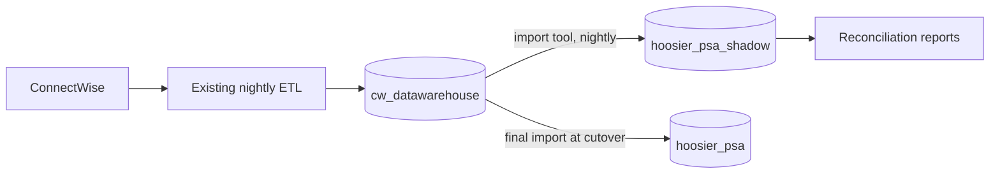

# 11. ConnectWise migration and cutover

## Strategy

**Parallel run, then hard cutover** at a month boundary. ConnectWise stays the system of record
while the new system is built. The new system continuously proves itself on real data in a **shadow**
environment, and production is populated only at cutover.

| Environment | Data | Who uses it |
|---|---|---|
| dev | Seed and test data | Developers |
| shadow | Wiped and re-imported nightly from the mirror | Testers, parallel-run comparison, demos |
| prod | Empty until cutover, then the system of record | Everyone |

Because staff keep working in CW during the build, shadow data is never edited by hand; test work
happens in dev or in clearly marked test records that the nightly re-import removes.

## Import tool (milestone 1)

- Lives in `packages/cw-import`; reads only through the read-only `cw_readonly` role on the mirror.
- **Re-runnable and idempotent.** Each target table has a `legacy_cw_*` unique column; the import upserts on it.
- **Preserves ids** for companies, contacts, tickets, projects and invoices ([ADR 0003](adr/0003-preserve-cw-ids.md)) using
  `OVERRIDING SYSTEM VALUE`, then advances each identity sequence beyond the maximum.
- Runs in dependency order inside one transaction per entity group: lookups, members, catalog, companies,
  sites, contacts, boards and statuses, tickets, notes, time entries, then agreements and billing in later milestones.
- **Reports exceptions rather than failing**: orphaned references, missing required values and duplicate
  identifiers go to an `import_exception` report with source id and reason, and the run continues.
- Emits a summary (rows read, written, skipped, excepted) compared with mirror counts as a built-in check.

### Mapping highlights

| CW (mirror) | New | Note |
|---|---|---|
| `companies.id`, `identifier` | `crm.company.id`, `identifier` | status, territory and types normalised to lookups |
| `service_tickets` (+ `board_name`, `status_name` copies) | `service.ticket` with ids only | names resolve by join |
| `service_tickets.resources` (text list) | `service.ticket_resource` | parsed; unmatched names become exceptions |
| `time_entries.charge_to_type` | `time_entry.charge_type` | `ServiceTicket`/`ProjectTicket`/other mapped; `billable_option` mapped to `billable` values |
| `time_entries.hourly_rate` | `bill_rate` snapshot | `cost_rate` from member cost at entry date |
| `members.inactive_flag` | `iam.member.is_active` | `identifier` kept for traceability |
| `agreements`, `agreement_additions` | `agreement.*` (M2) | cancelled and effective dates preserved |
| `invoices`, `invoice_line_items` | `billing.*` (M2) | invoice numbers preserved; mirror has partial line detail, so history before cutover is imported at invoice level where lines are missing |

### Known data issues to handle

- Fixed-fee project labor appears as a "LABOR COST" product line with cost equal to price; imported
  history is reclassified using time entries so margins are correct on day one.
- 148 projects unlinked to quotes (123 pre-CPQ legacy, 25 without an opportunity); imported with no
  quote link and flagged.
- `po_amount` on projects is unreliable and is not imported as revenue.
- Time entries and tickets referencing deleted or merged companies, contacts and members.

## Reconciliation reports (built alongside each module)

| Report | Compares | Pass criteria |
|---|---|---|
| Record counts | Rows per entity, CW vs shadow | Equal, or each difference explained by an exception row |
| Hours by member and period | Sum of time | Match to the minute for the last 12 months |
| Payroll export | PSA export vs the current spreadsheet for two periods | Identical regular, overtime and PTO hours |
| Open ticket list | Open tickets by board and owner | Identical |
| RMR | Monthly recurring revenue by agreement | Match within documented rounding rules |
| Invoice run | Invoices from a parallel billing run vs CW's | Same customers, lines and totals, differences itemised |
| QuickBooks | PSA exports vs `qb_invoices` from the nightly sync | Every posted invoice present once with the same amount |

## Cutover runbook (outline; finalised in M6)

1. **T-4 weeks.** Cutover date set at a month boundary; training; dry run into a scratch database.
2. **T-1 week.** Freeze configuration changes in CW (boards, statuses, rates). Second dry run, timed.
3. **T-1 day.** Last parallel billing run reconciled and signed off by the GM/Integrator.
4. **Cutover window** (after the final nightly ETL): CW set to read-only, final import into `hoosier_psa`,
   reconciliation suite run, spot-check by dispatch, billing and a technician.
5. **Go-live.** Staff sign in with Entra; the QuickBooks export is enabled; autopay stays off until its own sign-off.
6. **Hypercare** (first two billing cycles): daily reconciliation, same-day fixes, CW kept read-only for reference.
7. **Retirement.** After agreed sign-off, the CW subscription ends and the last export is archived.

**Rollback:** until the first posted invoice or payroll export from the new system, rollback means
re-enabling CW and discarding the new database. After that point rollback is a forward-fix; this is why
the first billing cycle runs under hypercare with CW still readable.
