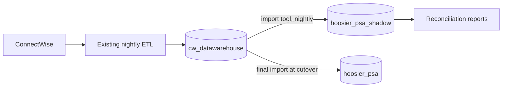

# 11. ConnectWise migration and cutover

## Strategy

**Parallel run, then hard cutover** at a month boundary. ConnectWise stays the system of record
while the new system is built. The new system continuously proves itself on real data in a **shadow**
environment, and production is populated only at cutover.



| Environment | Data | Who uses it |
|---|---|---|
| dev | Seed and test data | Developers |
| shadow | Wiped and re-imported nightly from the mirror | Testers, parallel-run comparison, demos |
| prod | Empty until cutover, then the system of record | Everyone |

Because staff keep working in CW during the build, shadow data is never edited by hand; test work
happens in dev or in clearly marked test records that the nightly re-import removes.

## Import tool (milestone 1)

- Lives in `packages/cw-import`; reads only through the read-only `cw_readonly` role on the mirror.
- **Re-runnable and idempotent.** Each target table has a `legacy_cw_*` unique column; the import upserts on it.
- **Preserves ids** for companies, contacts, tickets, projects and invoices ([ADR 0003](adr/0003-preserve-cw-ids.md)) using
  `OVERRIDING SYSTEM VALUE`, then advances each identity sequence beyond the maximum.
- Runs in dependency order inside one transaction per entity group: lookups, members, catalog, companies,
  sites, contacts, boards and statuses, tickets, notes, time entries, then agreements and billing in later milestones.
- **Reports exceptions rather than failing**: orphaned references, missing required values and duplicate
  identifiers go to an `import_exception` report with source id and reason, and the run continues.
- Emits a summary (rows read, written, skipped, excepted) compared with mirror counts as a built-in check.

### Mapping highlights

| CW (mirror) | New | Note |
|---|---|---|
| `companies.id`, `identifier` | `crm.company.id`, `identifier` | status, territory and types normalised to lookups |
| `service_tickets` (+ `board_name`, `status_name` copies) | `service.ticket` with ids only | names resolve by join |
| `service_tickets.resources` (text list) | `service.ticket_resource` | parsed; unmatched names become exceptions |
| `time_entries.charge_to_type` | `time_entry.charge_type` | `ServiceTicket`/`ProjectTicket`/other mapped; `billable_option` mapped to `billable` values |
| `time_entries.hourly_rate` | `bill_rate` snapshot | `cost_rate` from member cost at entry date |
| `members.inactive_flag` | `iam.member.is_active` | `identifier` kept for traceability |
| `opportunities` (+ stage and status names) | `sales.opportunity`, `sales.stage` | Ids preserved. CW keeps won and lost in the *status*, not the stage: `Won` goes to the Won stage; `Lost - *`, `Disqualified - *`, `Spam`, `Residential Lead`, `Sent to Service` and anything in the `10. Dead` stage go to Lost with the CW status kept as the lost reason. Everything else keeps its CW stage (stage names kept, sort order from the leading number, probability set per stage). The starter stages are deactivated unless in use. Created date is `date_became_lead`; owner is the primary sales rep; negative totals are left empty. |
| `projects` | `project.project` | Ids preserved. Status from the numbered CW status (`1.x` waiting on parts or paperwork becomes planning; `2`-`3` open; `5` on hold; `7` ready to invoice; `8` closed; `9` canceled). Manager matched by name to a staff member. `* MUST CHANGE` project types are left empty. No billing method becomes actual rates. |
| `project_phases` | `project.phase` | Ids preserved. Sub-phases are flattened into the project's list; ordered by WBS code as numbers (2 before 10); a repeated name gets its WBS code or id added. Only separately billed phases keep a billing method. |
| `agreements`, `agreement_additions` | `agreement.*` (M2) | cancelled and effective dates preserved |
| `invoices`, `invoice_line_items` | `billing.*` (M2) | invoice numbers preserved; mirror has partial line detail, so history before cutover is imported at invoice level where lines are missing |

### Known data issues to handle

- Fixed-fee project labor appears as a "LABOR COST" product line with cost equal to price; imported
  history is reclassified using time entries so margins are correct on day one.
- 148 projects unlinked to quotes (123 pre-CPQ legacy, 25 without an opportunity); imported with no
  quote link and flagged.
- `po_amount` on projects is unreliable and is not imported as revenue.
- **The warehouse has no fixed-fee amount for projects or phases.** Imported fixed-fee projects have an empty fee; every
  one that is still open (not closed or canceled) is listed as an import exception so the amount is entered by hand
  before the project is billed. Closed history does not need it.
- The warehouse project-to-opportunity link is not kept: a project has no opportunity column in the PSA (the link
  lives on the sales order that created it). Imported history is joined by customer and date if needed.
- Project tickets (`project_tickets`) are not imported yet, so project time entries keep their ticket reference but
  project tickets do not appear until that step is built.
- Time entries and tickets referencing deleted or merged companies, contacts and members.

## Reconciliation reports (built alongside each module)

| Report | Compares | Pass criteria |
|---|---|---|
| Record counts | Rows per entity, CW vs shadow | Equal, or each difference explained by an exception row |
| Hours by member and period | Sum of time | Match to the minute for the last 12 months |
| Payroll export | PSA export vs the current spreadsheet for two periods | Identical regular, overtime and PTO hours |
| Open ticket list | Open tickets by board and owner | Identical |
| RMR | Monthly recurring revenue by agreement | Match within documented rounding rules |
| Invoice run | Invoices from a parallel billing run vs CW's | Same customers, lines and totals, differences itemised |
| QuickBooks | PSA exports vs `qb_invoices` from the nightly sync | Every posted invoice present once with the same amount |

## Cutover runbook (outline; finalised in M6)

1. **T-4 weeks.** Cutover date set at a month boundary; training; dry run into a scratch database.
2. **T-1 week.** Freeze configuration changes in CW (boards, statuses, rates). Second dry run, timed.
3. **T-1 day.** Last parallel billing run reconciled and signed off by the GM/Integrator.
4. **Cutover window** (after the final nightly ETL): CW set to read-only, final import into `hoosier_psa`,
   reconciliation suite run, spot-check by dispatch, billing and a technician.
5. **Go-live.** Staff sign in with password and authenticator (accounts created beforehand with `pnpm auth set-password`); the QuickBooks export is enabled; autopay stays off until its own sign-off.
6. **Hypercare** (first two billing cycles): daily reconciliation, same-day fixes, CW kept read-only for reference.
7. **Retirement.** After agreed sign-off, the CW subscription ends and the last export is archived.

**Rollback:** until the first posted invoice or payroll export from the new system, rollback means
re-enabling CW and discarding the new database. After that point rollback is a forward-fix; this is why
the first billing cycle runs under hypercare with CW still readable.

## Import tool (`packages/importer`)

Re-runnable, id-preserving loader from the CW mirror (`cw_datawarehouse`, schema `production`) into a
non-production environment. Implemented so far: members, companies (with statuses and territories),
boards, statuses, priorities, ticket types and sources (derived from tickets), tickets, time entries.

```bash
APP_ENV=shadow DATABASE_URL=postgres://.../hoosier_psa_shadow CW_MIRROR_URL=postgres://cw_readonly@.../cw_datawarehouse \
  pnpm --filter @hoosier/importer import --dry-run     # report only; everything rolls back
```

Safety: the mirror is opened with `default_transaction_read_only=on` and may never equal the target;
the target must carry a matching environment marker; `production` is refused outright (it is loaded only
by the cutover procedure); the whole run is one transaction, so a failure leaves nothing half-imported.
Rows that cannot be imported become reported **exceptions**, never silent drops.

Behaviour worth knowing:
- **Idempotent.** Upserts on the `legacy_cw_*` keys (tickets and time entries also keep their CW id).
  Running it nightly refreshes shadow; changed source rows overwrite.
- **Sequences** advance past the highest *source* id, so numbers of skipped CW records are never reused.
- Naive mirror timestamps are read as `America/Indiana/Indianapolis` local time.
- Placeholder member emails (`@import.invalid`) until an administrator sets the real email.

### Gaps in the mirror that block full parity (action needed in the ETL)
The mirror stores names rather than ids for some fields and omits others. For these the importer uses
placeholders and says so in its exception report:

| Needed | Mirror today | Effect |
|---|---|---|
| Work role and work type per time entry | not captured | placeholders "Imported (unknown …)"; payroll-neutral, billing-relevant |
| Time entry status, invoice link, approval | not captured | all imported time is `approved`; billed history needs the invoice link |
| Ticket contact id, site id, resources | contact name only; no site; resources as text | contact linked by unique (company, name) match, ambiguous or unknown names are tallied; site and resources not imported |
| Company billing profile (tax, terms, bill-to, QuickBooks link) | partly present | not imported yet |
| Board status default | CW has no default flag | rule: open status named "New…", else first open; reviewed in UAT |
| Ticket statuses missing from `board_statuses` | a few (20 in the live mirror) | derived from tickets and reported |
| Member email, cost history | cost only | placeholder email; cost snapshot uses current cost |

Imported today: members, companies, sites (street/city/state/zip parsed; other formats stay in line 1;
duplicate names per company get the CW id appended), contacts with email and phone channels (E.164,
extensions split out, one default per kind), company default/billing contacts and sites, work roles and
work types (rate type, minimum/maximum hours, billing flag), boards, priorities, board statuses (closed
and inactive flags from CW), tickets, ticket notes (kind precedence: description, resolution, internal,
discussion; empty notes skipped) and time entries. Noisy, row-level problems are counted in the report
summary rather than listed one per row.

Not yet implemented: agreements, invoices, projects, products and the rest of the catalog.
